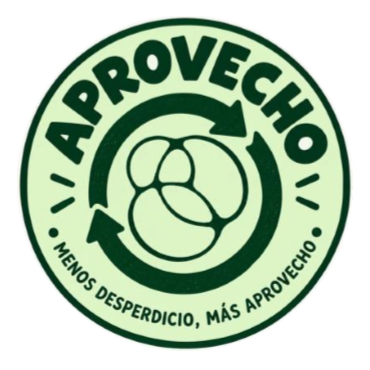
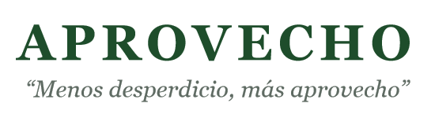

# Marca actual de APROVECHO (estado según el plan de negocios)

> Inventario de **lo que ya existe** en el plan "Entregable 3" y en sus mockups. Es el punto de partida del agente de marca. **No es la identidad final**: ver las observaciones al final.
> Imágenes: `docs/marca/referencias-plan/` (logo recortado) y `docs/fuente/imagenes/13-*.jpg`, `11-*.jpg` y `00-portada.jpg`.

## Nombre y slogan

- **Nombre:** APROVECHO, siempre en mayúsculas en el plan. Juego de palabras entre "aprovecho" (primera persona de *aprovechar*) y "buen provecho".
- **Slogan:** **"Menos desperdicio, más aprovecho"**. Aparece en el logo y en la portada.
- **Planes:** APROVECHO **Base**, **Smart** e **Intelligence**. Mezclan castellano con inglés; el plan también usa "Score".

## Logo actual

- **Badge circular:** fondo verde menta y borde verde bosque. Arriba, "APROVECHO" en arco con tipografía bold redondeada; abajo, "MENOS DESPERDICIO, MÁS APROVECHO" en arco; a los costados, marcas cortas tipo "brillo".
- **Centro:** dos flechas circulares (ciclo o reaprovechamiento) alrededor de una **forma orgánica con lóbulos** (¿un pan o bollo? ¿un alimento estilizado?). La lectura es ambigua.
- **Wordmark de la portada:** "APROVECHO" en una **serif** (tipo Georgia o Didone) espaciada, con el slogan entre comillas en serif itálica gris.

## Manual de marca básico (mockup del plan, sección 13.3)

Archivo: `docs/fuente/imagenes/13-3-manual-de-marca-basico.jpg`.

| Elemento | Valor |
|---|---|
| Verde Bosque | `#1A4D3A` |
| Verde Menta Suave | `#DFFFD6` |
| Crema Natural | `#F5F5DC` |
| Gris Carbón | `#333333` |
| Tipografía de títulos | **Montserrat Bold** |
| Tipografía de texto | **Open Sans Regular** |
| Aplicaciones mostradas | A) bolsa biodegradable, B) cartelería del comercio (atril "¡BIENVENIDOS! Alimentos frescos y sostenibles · Horario 9:00–20:00"), C) interfaz de la app |

## Colores y estilo observados en los mockups (no están en la paleta oficial)

- **Verde medio y saturado** en botones y acentos de la app y los dashboards (aprox. `#2E7D32`), además del verde bosque.
- **Durazno o coral suave** con texto naranja en las etiquetas "Estimado" y "Datos de ejemplo". Es un acento cálido que de hecho ya funciona como código de **transparencia** (estimado vs. medido).
- UI clara: fondos blanco o crema, tarjetas con números grandes en verde bosque, íconos de línea verdes y mucho aire.
- Fotografía cálida y realista de panaderías y cafeterías (luz de atardecer, cajas kraft, medialunas). Estética "barrio y comercio de cercanía".

## Tono (sección 13.3)

- Hablar del desperdicio como **oportunidad**, no desde la culpa.
- **B2C:** cercano, simple y con humor; ahorro, descubrir lugares y la sorpresa del pack.
- **B2B:** profesional y concreto; plata recuperada, tiempo ahorrado y datos.
- Misma identidad para los dos públicos; cambian el tono y el beneficio que va primero.

## Copys que ya aparecen en las piezas

- "Encontrá packs sorpresa a mitad de precio."
- "Rescatá comida en perfecto estado de este y otros comercios cercanos."
- "Escaneá y bajate la app." · "Escaneá y descargá la app." · "Escaneá y probá la app."
- "Convertí excedentes en ingresos." · "Publicá packs sorpresa, recuperá valor y mostrale a tu comunidad tu impacto."
- "Publicación simple desde el celular" · "Más recuperación, menos desperdicio" · "Sumá tu comercio a APROVECHO"
- "Conocé APROVECHO. La app que te conecta con alimentos de calidad que no se vendieron a tiempo, a un mejor precio." · "Reducí el desperdicio · Ahorrá · Cuidá el planeta"
- "SALVÁ ESTA COMIDA HOY"
- En la app y los dashboards: "Tu resumen", "Tu impacto", "Medí y entendé tus excedentes", "Anticipá excedentes y decidí con tiempo", "Huella asociada", "No equivale directamente a emisiones evitadas."
- Mensajes por segmento del plan: ver `docs/fuente/06-marketing-y-comercial.md`.

## Observaciones críticas (para el agente de marca)

1. **Logo:** es un raster de baja resolución generado con IA (unos 340 px) y no sirve para producción. Hay que **vectorizarlo o redibujarlo**. Además:
   - El ícono central es ambiguo: no se entiende qué alimento es.
   - El texto en arco es ilegible en tamaños chicos (ícono de app, favicon, sticker chico).
   - Falta un sistema de versiones: badge completo, **isotipo** simplificado, **wordmark horizontal**, versiones monocromas y en negativo.
2. **Inconsistencia tipográfica:** serif en la portada, Montserrat en el manual y otras sans en los gráficos.
3. **Varias "marcas" conviviendo:** el badge, una hoja junto al wordmark (gráficos de encuestas), una hoja sola como símbolo en el diagrama del ecosistema y un ícono circular en el diagrama de flujo.
4. **El mockup del manual tiene errores:** "PROVECHO" y "2024".
5. **Categoría saturada de verde y hojas:** Cheaf, Buen Provecho y Too Good To Go usan verdes y hojas. El verde solo no diferencia; hace falta un rasgo propio (un acento cálido, ilustración, forma o tono de voz).
6. **El nombre es parecido a "Buen Provecho"** (ver `docs/fuente/09-inconsistencias-y-preguntas.md`, A1).
7. **Montserrat + Open Sans** es una combinación muy genérica. Sirve como base, pero tiene poca personalidad para una marca que quiere verse muy profesional.
8. **Arquitectura de marca:** hay que definir cómo conviven la marca de consumo (cercana y con humor) y la B2B (Base, Smart e Intelligence, profesional), y si los nombres de los planes quedan en inglés.
