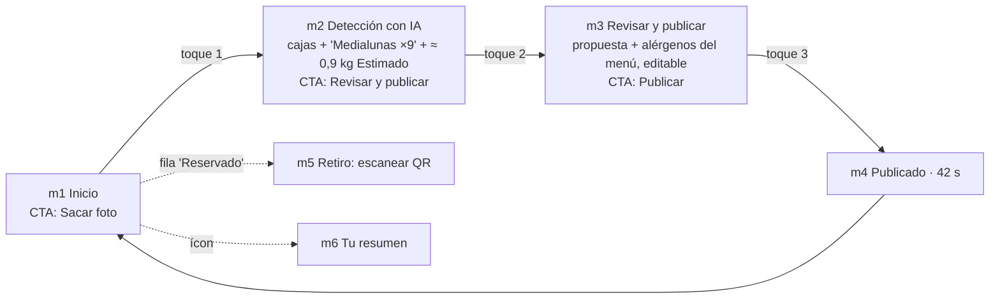
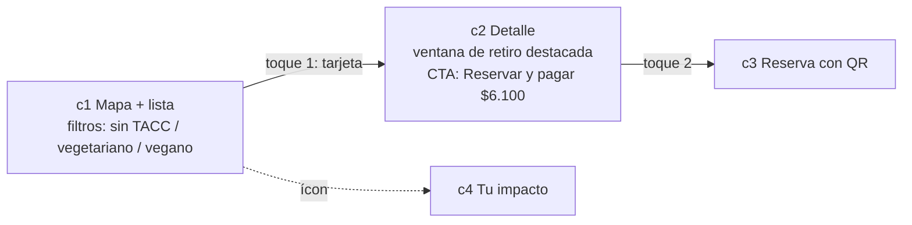

# Flujo v2: simplificado y con Vision Recognition protagonista

> UX · 2026-11-03 · reemplaza a los wireframes v1 como **referencia para construir el prototipo**. Pantallas: `v2/index.html`.
> Responde la devolución del usuario: v1 genérico, con demasiados botones y sin Vision Recognition visible.

## Reglas de diseño
1. **Un solo CTA principal por pantalla**, sin botones secundarios. Lo demás son filas tocables o íconos de cabecera.
2. **La IA hace el trabajo y se ve**: cajas de detección con etiqueta y cantidad, peso total [Estimado], "Propuesta lista".
3. **La persona confirma**: todo se edita tocando el campo; el CTA "Publicar" lleva la confirmación explícita.
4. Estimado vs. Medido en cada cifra; ventana de retiro destacada antes de pagar.
5. Skin provisoria: #1A4D3A, #DFFFD6, #F5F5DC, #333333; Montserrat / Open Sans; "Estimado" en durazno (como en los mockups del plan).

## Comercio: 3 toques

- **m2** se explica en 3 segundos: foto real, escaneo, cajas numeradas que aparecen una a una, chip "Medialunas ×9", tarjetas "Detectamos / Peso / La IA propone" y recién ahí aparece el CTA.
- **m3** une propuesta y checklist. **Alérgenos precargados desde el menú del comercio** (el comercio los confirma al publicar; la IA nunca los decide).
- **m5**: el escaneo valida solo (simulado); no hay botón.

## Consumidor: 2 toques hasta el QR

Medio de pago guardado: no hay pantalla de pago. El pago se confirma con ese único toque.

## Casos del plan en v2 (sin pantallas propias)
| Caso | Cómo se resuelve |
|---|---|
| Pago fallido | Aviso arriba en c2 ("No pudimos cobrar, no se generó la reserva") y el mismo CTA queda activo para reintentar |
| Cancelación | Regla visible en el CTA ("gratis hasta 2 h antes"); la acción vive en la fila de la reserva (c3) |
| Comercio sin el pack | Aviso + devolución total en c3; el comercio lo marca desde la fila del pack en m1 |
| Pack en mal estado | Después del retiro, aviso en c3/c4 "¿Hubo un problema?" (foto obligatoria) |
| Estados vacío / cargando / error | Esqueletos y mensajes de una línea dentro de la misma pantalla; ver `flujos.md` (siguen vigentes) |

## Pantallas viejas (v1) que quedan obsoletas
**Reemplazadas o absorbidas (se pueden archivar):**
- Comercio: `m02`, `m02b`, `m02c` → **m2 v2**; `m03`, `m04` → **m3 v2** (propuesta y checklist juntos); `m05` → **m4 v2**; `m06`, `m06b`, `m07` → filas de **m1 v2**; `m07b`, `m07d` → **m5 v2**; `m08` → **m6 v2**; `m01` → **m1 v2**.
- Consumidor: `c01` (registro, queda fuera de la demo), `c02` + `c03` → **c1 v2**; `c04` → **c2 v2**; `c05` (pago) → absorbida en el CTA de c2; `c07` → **c3 v2**; `c09` → **c4 v2**.

**Siguen vigentes como referencia de lógica (no se rediseñaron):** `c06` pago fallido, `c07b` cancelar, `c07c` comercio sin pack, `c08`/`c08b` calificación y reporte, `c11`/`m09` estados, `m07c` no retiró, `m07e` QR inválido, `m10` Smart y `m11` Intelligence (estáticas). Si se construyen, deben heredar el skin y la regla de un solo CTA.

`alcance-prototipo.md`, `flujos.md` y `score-y-niveles.md` siguen válidos; este documento prevalece en pantallas y cantidad de pasos.

## Decisiones propuestas (PROPUESTA, necesitan OK)
1. El CTA "Publicar" **reemplaza** al checklist de 3 casillas (D-014): al tocarlo el comercio confirma producto del día, cadena de frío y alérgenos (texto visible bajo el botón). Si el usuario prefiere casillas explícitas, son 3 toques extra y se pierde el objetivo de 3 toques.
2. Alérgenos precargados desde el menú: implica que la configuración del local (menú con alérgenos) es obligatoria en el alta.
3. Medio de pago guardado: el primer pago pide cargarlo (fuera del prototipo).

## Supuestos y límites
- **SUPUESTO:** 9 medialunas ≈ 0,9 kg, 3 packs de 3 unidades, $6.100 c/u (D-015); la detección usa una foto única con coordenadas fijas. La detección es **simulada**.
- Solo hay una clase detectada porque la foto de ejemplo es una bandeja homogénea; con un segundo producto se vería "Budín ×2". Falta una foto libre real de ese caso.
- El logo es el raster del plan (D-011 lo va a reemplazar).
- Sin la skill `frontend-design` (no estaba disponible en esta sesión): el diseño es criterio propio.
