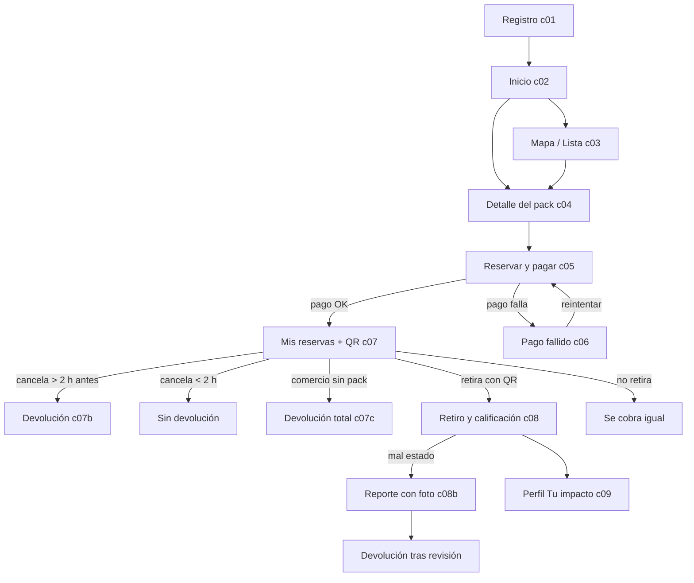
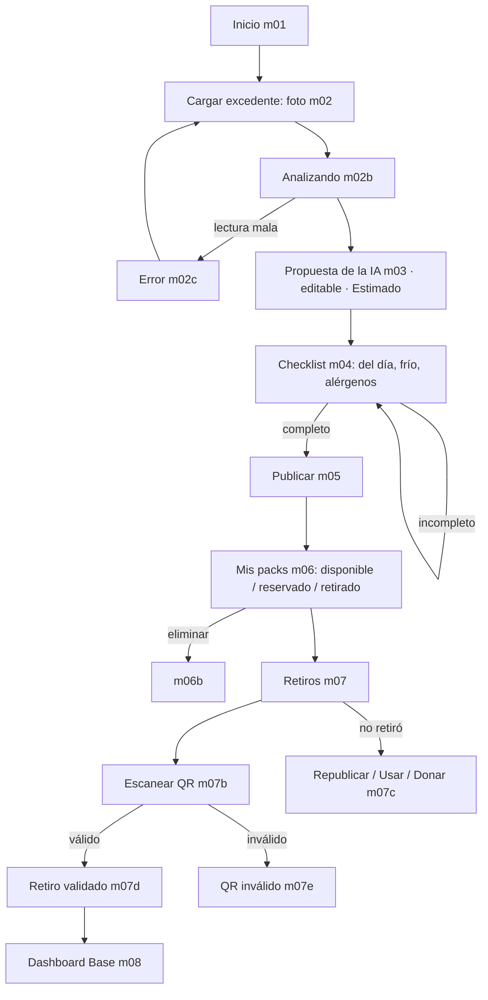

# Flujos y estados

> Rol UX · 2026-11-03. Casos y reglas de `docs/fuente/07` (14.4). Pantallas: ver `wireframes/`.

## Consumidor

## Comercio (Base)

## Estados por pantalla clave

| Pantalla | Vacío | Cargando | Error | Éxito |
|---|---|---|---|---|
| Inicio consumidor | "Hoy no hay packs cerca" + avisarme / ampliar radio | Esqueleto de tarjetas | "No pudimos cargar los packs" + reintentar | — |
| Mapa/lista | Igual al de inicio | Mapa gris + lista esqueleto | Reintentar | — |
| Reservar y pagar | — | Botón "Pagando…" bloqueado (evita doble cobro) | **Pago fallido**: no hay reserva ni QR, se puede reintentar | Reserva confirmada + QR |
| Mis reservas | "Todavía no reservaste nada" + ver packs | Esqueleto | Reintentar | Aviso "Reserva confirmada" |
| Cargar excedente | — | "Analizando…" (barra) | "Foto movida/oscura": otra foto o cargar a mano | Propuesta lista |
| Propuesta | — | — | Campo inválido (precio vacío) con mensaje junto al campo | — |
| Checklist | — | — | Botón "Publicar" deshabilitado y razón visible | — |
| Mis packs | "Todavía no publicaste packs hoy" | Esqueleto | "No pudimos publicar. Tu carga está guardada" | "Publicaste N packs" |
| Retiros | "No hay retiros pendientes" | — | QR inválido | Retiro validado |
| Dashboard | "Aparece con tu primera venta" | Esqueleto | Reintentar | — |

## Casos del plan (14.4)

| Caso | Qué ve el consumidor | Qué ve el comercio | Regla |
|---|---|---|---|
| **Cancelación** | Botón "Cancelar". Hasta 2 h antes del retiro: devolución. Después: mensaje "ya no se puede cancelar con devolución" | Pack vuelve a "Disponible" | El plazo se muestra **antes de pagar** (c05) |
| **Comercio sin el pack** | Aviso + devolución total + sugerencia de otros packs | Incidencia registrada; **baja su Score**; si se repite, suspensión | Se dispara desde el comercio ("No tengo el pack") o desde un reporte |
| **Pack en mal estado** | Reporte con **foto obligatoria**; devolución | Incidencia; APROVECHO revisa; si se repite, suspensión | Alérgenos/salud: soporte atiende en el momento |
| **Pago fallido** | "No se generó reserva ni QR" + reintentar / cambiar medio | Nada | No hay estado intermedio: sin pago, sin reserva |
| **No retira** | Se cobra igual (se avisa en c05) | Republicar / usar / donar | Se marca en la app |
| **Falla la estación (Smart)** | — | Sigue cargando con el celular como en Base | Aviso en `m10` |

## Notas
- **PREGUNTA:** ¿se avisa al consumidor cuando falta 1 h para cerrar la ventana de retiro? (el plan prevé avisos; el prototipo no los incluye).
- El retiro "fuera de ventana" no está definido en el plan: se propone que el QR no valide fuera de la franja. **PROPUESTA**, a confirmar.
