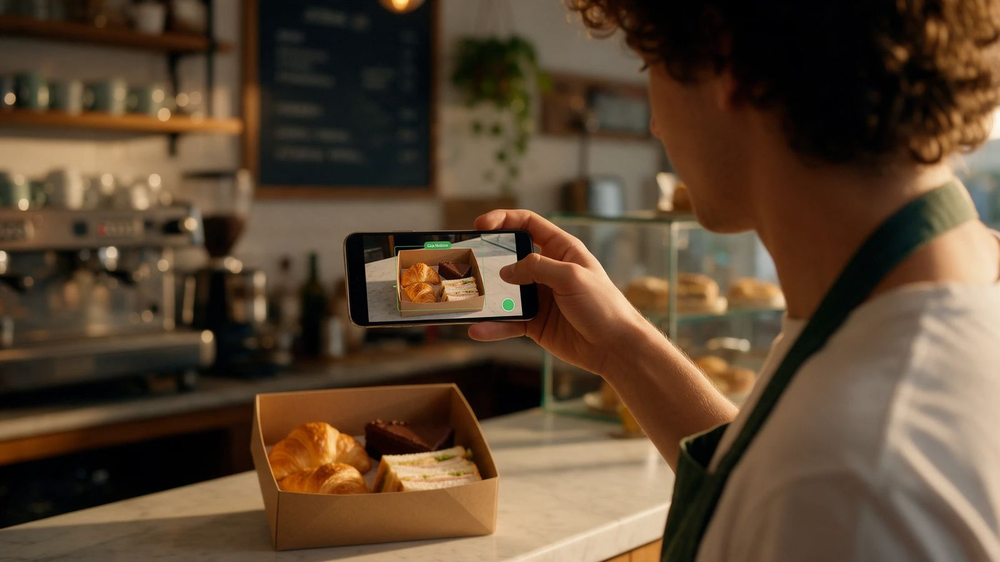
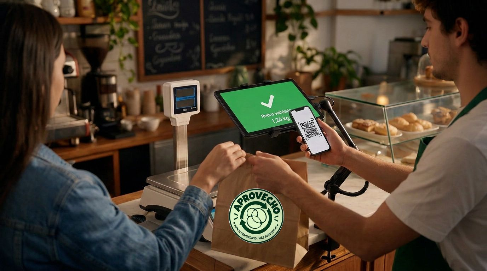
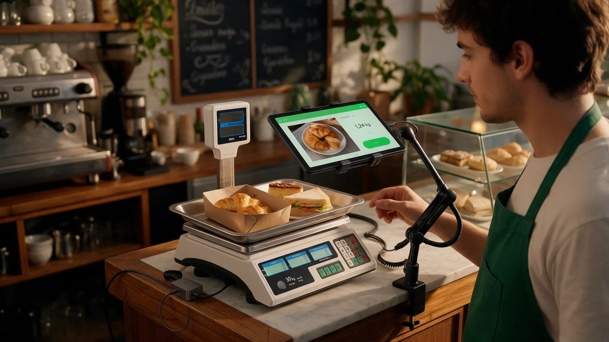

# APROVECHO · Guiones, storyboard y producción

Brief [06 · Guion y video](../docs/briefs/06-video.md) · 4 de noviembre de 2026 · Para revisión.

El primer corte es **«Una foto»** (24 s, vertical). Los textos cuentan el recorrido completo y se leen con el audio silenciado. La edición usa fotos existentes y pantallas de la demo. El audio de cada cuadro describe la intención para la versión final. El primer corte se monta sin voz contratada y con presupuesto de **USD 0**.

## 1 · La vida de una medialuna

**76 s · 16:9 · Presentación para jurado e inversores.** Seguí la medialuna desde el horno hasta el retiro. El cierre vuelve al obrador para mostrar cómo los datos orientan la producción de mañana.

| Tiempo | Cuadro y movimiento | Voz en off | Texto en pantalla | Música y SFX |
|---|---|---|---|---|
| 00–08 s | Plano cerrado de una medialuna dorada. La bandeja ocupa el tercio inferior. Corte a las pinzas sobre el mostrador. | «Sale del horno y va al mostrador. Ahí espera a que alguien la elija.» | «A la mañana» | Sonido de bandeja y obrador. Entra una guitarra suave con dos notas. |
| 08–18 s | Mismo encuadre al cierre. Quedan varias piezas en la bandeja. Luz más baja y plano quieto. | «Al cierre todavía queda comida del día. Martín ya puso la harina, la manteca y las horas de horno.» | «Al cierre» | Baja la música. Se oyen las pinzas sobre la bandeja. |
| 18–33 s | Foto del excedente a la izquierda y captura de la detección a la derecha. Las cajas dan paso a revisión y publicación. | «Con APROVECHO, Martín le saca una foto a lo que sobró. La app propone los packs y el precio sale de su carta. Martín revisa y confirma.» | «Foto → propuesta → confirmación» · «Prototipo · Detección simulada» | Clic de cámara, luego un toque seco al confirmar. |
| 33–45 s | Teléfono con un pack del barrio. Corte al QR en el mostrador y a una bolsa que cambia de manos. | «A Sofía le queda de paso. Reserva el pack a mitad de precio y lo retira con un QR. Martín se queda con el setenta y cinco por ciento del precio del pack.» | «A mitad de precio» · «25% de comisión» | Recuperá el pulso y sumá un sonido breve de confirmación. |
| 45–55 s | Mostrador a la izquierda y resumen del comercio a la derecha. Señalá ventas y el tipo de dato sin destacar valores del ejemplo. | «Cada venta deja un dato. Martín puede ver qué le sobró, cuánto recuperó y cuándo pasó.» | «Datos de la operación» · «Ejemplo de la demo» | Sigue la guitarra, más baja bajo la voz. |
| 55–69 s | Tres cuadros consecutivos. Celular de Base, estación de Smart y panel de Intelligence. Conservá el mismo eje para que se entienda la progresión. | «Base ayuda a recuperar ingresos desde el celular. Smart suma la balanza para medir. Intelligence cruza los datos de las sucursales para anticipar excedentes.» | «Base · Recuperá» / «Smart · Medí con balanza» / «Intelligence · Anticipá» | Un toque suave en cada cambio. |
| 69–76 s | Volvé a la bandeja de apertura. Martín revisa cuánto preparar. Cerrá con el sello oficial sobre crema. | «Mañana, con ese dato, Martín puede ajustar cuánto hornea.» | «Menos desperdicio, más aprovecho» · «Conocé el proyecto» | Resuelve el motivo musical y deja respirar el cierre. |

**Referencias de cuadro.** `app/img/fotos/medialunas.webp` para textura y color. `foto-celu-caja.jpg`, `retiro-qr-v2.jpg` y `estacion-balanza-tablet.jpg` del banco aprobado para encuadre. Para el producto, capturas de consumidor, Base, Smart, Intelligence y detección del prototipo. La jornada de Martín y Sofía es una dramatización. Si faltan tomas propias del horno y del mostrador, usá fotos reales con corte por encuadre y mantené la puesta en escena ilustrativa.

## 2 · Una foto

**24 s · 9:16 · Publicidad para comercios, plan Base.** Una bandeja, una foto, una confirmación y un retiro. El ritmo muestra el flujo de la demo.

| Tiempo | Cuadro y movimiento | Voz en off opcional | Texto del primer corte | Música y SFX |
|---|---|---|---|---|
| 00–03 s | Foto a sangre de facturas en el mostrador. Titular en el tercio superior sobre una banda verde bosque. | «¿Qué hacés con lo que te sobra?» | «¿Qué hacés con lo que te sobra?» | Golpe seco de bandeja y pulso acústico. |
| 03–07 s | Encuadre al celular que fotografía el excedente. Mantené la acción en el centro para que se lea en vertical. | «Sacale una foto a lo que sobró.» | «Sacale una foto a lo que sobró.» | Clic de obturador opcional. |
| 07–12 s | Captura de detección con varios productos y cantidades. Corte a revisión y confirmación. | «La app propone. Vos confirmás.» | «La app propone. Vos confirmás.» · «Prototipo · Detección simulada» | Un toque discreto en la confirmación. |
| 12–16 s | Pantalla de reserva seguida por el QR. Si se ilustra el gesto con una foto, recortá a las manos y el celular para representar el retiro en Base. | «Reservan en la app. Retiran con QR.» | «Reservan en la app. Retiran con QR.» · «Prototipo» | Sonido corto de retiro validado. |
| 16–19 s | Placa limpia con el porcentaje como foco y la base del cálculo justo debajo. | «Recibís el setenta y cinco por ciento.» | «Te quedás con el 75% del precio del pack.» · «25% de comisión» | Baja la música para que el corte no compita con la lectura. |
| 19–24 s | Sello oficial y CTA sobre crema. Dejá el llamado visible durante todo el cuadro. | «Sumá tu comercio. Con Base, pagás solo cuando vendés.» | «Sumá tu comercio» · «Plan Base» · «Sin abono. Pagás solo cuando vendés.» | Cierre acústico. Sin voz en el primer corte. |

**Referencias de cuadro.** `app/img/fotos/facturas.webp`, `docs/marca/imagenes-aprobadas/foto-celu-caja.jpg`, captura de detección `app/capturas/06-deteccion.png` y retiro por QR del prototipo. Si una pantalla queda chica, recortá al detalle relevante y repetí el dato esencial como texto de edición. Reservá margen arriba, abajo y a la derecha para la interfaz del reproductor. La publicación del corte y el enlace de destino del CTA requieren revisión.

## 3 · ¿Qué me tocó hoy?

**25 s · 9:16 · Publicidad para consumidores.** Recreación de un unboxing a la salida del local. El remate nace de abrir el pack y encontrar una merienda.

| Tiempo | Cuadro y movimiento | Voz en off o diálogo | Texto en pantalla | Música y SFX |
|---|---|---|---|---|
| 00–03 s | Bolsa cerrada en primer plano, con una mano que empieza a abrirla. Corte antes de mostrar el interior. | «Pagué la mitad. A ver qué me tocó hoy.» | «Un pack sorpresa a mitad de precio» · «Escena ilustrativa» | Sonido de papel y arranque liviano. |
| 03–08 s | Mapa o inicio del prototipo y detalle de un pack. Cortá al horario de retiro. | «Vi un pack de pastelería y me quedaba de paso.» | «Elegí cerca» · «Prototipo» | Paso breve y toque de pantalla. |
| 08–12 s | QR en el celular, mostrador y bolsa que llega a cuadro. | «Lo reservé y mostré el QR en el local.» | «Retirá con QR» · «Prototipo» | Confirmación suave y ambiente de local. |
| 12–19 s | La bolsa se abre. Mostrá una porción de torta y facturas en dos planos cortos. | «Torta y facturas. Bueno, ya tengo merienda.» | «Lo que trae cambia según el día» | Papel, pausa y vuelta de la música. |
| 19–25 s | Sello sobre fondo crema, con una toma breve de la merienda a un costado. | «¿Qué te va a tocar a vos? Anotate y te avisamos cuando llegue a tu barrio.» | «Avisame cuando llegue a mi barrio» | Remate de dos notas. |

**Referencias de cuadro.** `app/capturas/01-consumidor.png`, `app/img/fotos/torta.webp` y `app/img/fotos/facturas.webp`. Para la bolsa y la apertura, usá planos propios de manos y mostrador con autorización. Si esos planos faltan, resolvé el descubrimiento con el corte de una bolsa cerrada a dos fotos de comida. La pieza usa el llamado de lista de espera de D-024. La captación real depende de la landing y de la aprobación del enlace.

## 4 · Primer pack, del alta al retiro

**60 s · 16:9 propuesto · Onboarding para comercios, plan Base.** Mostrá las pantallas reales del prototipo. La versión horizontal deja leer los controles y permite ubicar la instrucción al lado de la captura.

| Tiempo | Cuadro y movimiento | Voz en off | Texto en pantalla | Música y SFX |
|---|---|---|---|---|
| 00–06 s | Sello arriba a la izquierda. Al lado, abrí el selector de comercio del prototipo. | «Vamos a publicar tu primer pack con APROVECHO Base.» | «Tu primer pack» · «Prototipo» | Base acústica tranquila. |
| 06–17 s | Elegí Plan Base, recorré la carta y completá el horario del local. Un recorte por acción. | «Entrá como comercio. Elegí Base, revisá la carta y cargá los datos de tu local. De esa carta salen los precios habituales.» | «1 · Configurá tu comercio» | Toques suaves al cambiar de pantalla. |
| 17–29 s | En Hoy, abrí la cámara. Pasá de la foto de muestra al cuadro de detección múltiple. | «Desde Hoy, sacale una foto al excedente del día. Revisá qué productos detectó la app y cuántos hay.» | «2 · Sacá una foto» · «Detección simulada» | Obturador. Mantener la música debajo de la voz. |
| 29–45 s | Recortá sobre la cantidad y el horario de retiro. Mostrá las tres casillas en orden y después el botón de publicar. | «Revisá los packs y el horario de retiro. Confirmá que la comida sea del día, verificá la cadena de frío cuando corresponda e informá los alérgenos y si es sin TACC. Después, tocá Publicar.» | «3 · Revisá y publicá» · «Producto del día · Cadena de frío · Alérgenos y sin TACC» | Un toque al publicar. |
| 45–56 s | Cliente con reserva activa y QR. Corte a Retiros del comercio, lectura del QR o ingreso del código y confirmación. | «Cuando llegue el cliente, abrí Retiros. Escaneá su QR o ingresá el código. Confirmá la entrega cuando le des el pack.» | «4 · Validá el retiro» · «Operación de ejemplo» | Confirmación breve, con pausa para leer el estado. |
| 56–60 s | Volvé a Hoy y mantené el estado de entrega en pantalla antes del sello. | «Listo. Ya quedó registrado tu primer retiro.» | «Menos desperdicio, más aprovecho» | Cierre corto y limpio. |

**Referencias de cuadro.** Partí de `app/capturas/02-base.png` y `app/capturas/06-deteccion.png`. Recapturá el selector Base, la carta, la propuesta, el checklist, la reserva y Retiros desde el prototipo local para que los botones y estados coincidan con la versión de entrega. El formato y el uso del onboarding junto a la landing quedan para validar en D-030.

## Referencias visuales del storyboard

| Encuadre de foto para Base | Gesto de retiro | Estación Smart |
|---|---|---|
|  |  |  |
| Tomá el encuadre como referencia. Mostrá la interfaz real en el cuadro de detección. | La imagen incluye equipo de Smart. Para Base, mostrá el QR y las manos con la captura de la demo aparte. | Usala como referencia de montaje y recortá el peso ilustrativo de la pantalla. |

## Presupuesto de producción

Estimación de gasto externo por pieza. La edición en Remotion y las capturas locales usan el entorno del proyecto. La voz prevista puede grabarse con el equipo y quedar sujeta a su disponibilidad. La mezcla puede hacerse con sonido directo propio y una pista libre con licencia revisada para su uso.

| Pieza | Insumos previstos | Costo estimado | Decisión antes de producir |
|---|---|---:|---|
| La vida de una medialuna | Fotos y planos de obrador y mostrador, capturas de app, voz del equipo y sonido directo | USD 0 | Confirmar locación y permisos si se filman manos o mostrador. El corte con fotos existentes conserva la estructura. |
| Una foto | Fotos disponibles, capturas, placas de texto y sello | **USD 0** | Revisar el primer corte de 24 s. Mantener la edición comprensible en silencio. |
| ¿Qué me tocó hoy? | Bolsa, fotos de comida, captura de consumidor y retiro, voz del equipo si hay toma propia | USD 0 | Confirmar permisos de la recreación y el destino de lista de espera antes de publicar. |
| Primer pack | Capturas locales, placas e indicaciones sobre los controles, voz del equipo si se aprueba | USD 0 | Validar formato de onboarding y recorrida final del prototipo. |

Si más adelante se aprueba voz sintética, [D-023 y herramientas](../docs/herramientas.md) manejan como referencia un plan de alrededor de **USD 6 por un mes** compartido entre piezas. El costo y la licencia comercial se confirmarían antes de contratar. El primer corte de «Una foto» se puede revisar con sus textos y fotos.

## Entrega y revisión

- Usá el [sello oficial](../docs/marca/logo-oficial/) y la [paleta de marca](../docs/marca/tokens.css). Mantené el sello separado de las fotos para que se lea. Revisá el contraste y la duración de cada placa en el tamaño final.
- Para capturas del prototipo, usá datos demo y ocultá información personal. La etiqueta «Prototipo» acompaña las pantallas. Cualquier valor ambiental visible lleva «huella asociada estimada». Cuando aparezcan pesos, conservá «Medido» o «Estimado» según su origen.
- Para fotos de stock, conservá su atribución y fuente. Las capturas `app/capturas/` y fotos `app/img/fotos/` vienen del prototipo de la [rama de app](https://github.com/ochomnalez/APROVECHO-online-/pull/3). El [banco visual aprobado](../docs/marca/imagenes-aprobadas/) sirve como referencia y como insumo donde corresponde. El onboarding se captura desde la aplicación.
- Prepará las composiciones verticales a 1080 × 1920 y las horizontales a 1920 × 1080. Revisá un MP4 local con audio y sin audio, los textos de cierre y la legibilidad de las acciones. Agregá subtítulos si el corte incluye voz.
- El **50%** corresponde al descuento sobre el precio habitual. En **Base**, el **25%** de comisión se aplica al precio del pack vendido y el comercio recibe el **75%**. Los nombres, beneficios y CTA se apoyan en [el producto y los planes](../docs/fuente/04-producto-y-planes.md), [los conceptos aprobados](../docs/marketing/conceptos-videos.md), [las decisiones](../docs/decisiones.md) y [la revisión de inconsistencias](../docs/fuente/09-inconsistencias-y-preguntas.md).
